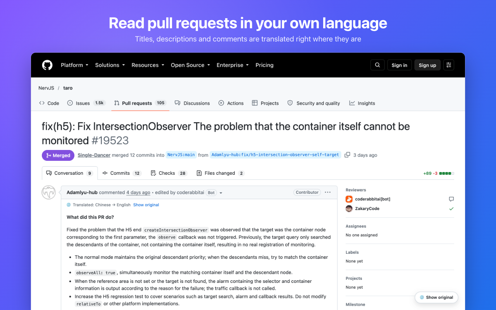

<div align="center">


# Aspid Lingo for GitHub

**Review pull requests in your own language.**

A Chrome extension that translates pull requests, code review, commits and READMEs
right on github.com. Free, private, on your device, and it never touches your code.


[](../../LICENSE)

[Install](#install) · [Features](#features) · [Privacy](#privacy) · [FAQ](#faq)

</div>



## Why

Code review is hard enough without a language barrier. Some great projects discuss changes
in Chinese, Japanese or Russian, and plenty of teams review in an English that not everyone
reads fluently. Then a PR takes twice as long to read, and details slip through.

Aspid Lingo puts the translation exactly where the original was: in the PR description,
in review threads, in the commit list. Code, links and mentions stay as they are,
and the original is always one click away.

## Features

- **The whole pull request.** The title, description, conversation, review comments,
  commit titles and commit messages. Repository READMEs and rendered `.md` files too.
- **Code stays code.** Code blocks, inline code, identifiers such as `SerializeReference`,
  @mentions, #issue references, links, conventional commit prefixes (`fix(scope):`)
  and git trailers (`Co-Authored-By:`) are never translated.
- **Free and private.** Translation runs on your device with the translator built into Chrome.
  No account, no API key, no servers, nothing to pay for.
- **The original is one click away.** Every comment has its own toggle, titles and commits
  show the original on hover, and a floating button flips the whole page.
- **Fast on huge PRs.** Only what scrolls into view gets translated, and text that is
  already in your language is skipped.
- **Keeps up with GitHub.** New comments, edited comments and page switches without a reload
  are picked up on their own. README tables of contents keep working.
- **Your rules.** Pick the target language, translate automatically or on demand, and choose
  what to translate: turn off commits, READMEs or review comments with one checkbox.
- **Speaks your language.** Translate into any of the 39 languages of Chrome's built-in
  translator. The target follows your browser's preferred languages until you pick another one,
  and the settings page switches to the language you translate into.

## Where it works

| Page | What gets translated |
|---|---|
| Pull request, all tabs | Title, description, comments, review threads, commits |
| Commit list | Commit titles and descriptions |
| Single commit | Commit title and description |
| Repository home and folders | README |
| Any `.md` file | The rendered document |

Translates into Arabic, Bengali, Bulgarian, Chinese (Simplified and Traditional), Croatian, Czech,
Danish, Dutch, English, Finnish, French, German, Greek, Hebrew, Hindi, Hungarian, Indonesian,
Italian, Japanese, Kannada, Korean, Lithuanian, Marathi, Norwegian, Polish, Portuguese, Romanian,
Russian, Slovak, Slovenian, Spanish, Swedish, Tamil, Telugu, Thai, Turkish, Ukrainian and
Vietnamese. The settings page and the labels on GitHub speak the same languages.

## How it works

1. Install the extension. It translates into your browser's language; change it in the settings if you like.
2. Open any pull request on GitHub. The first time, click the 🌐 button in the bottom right
   corner: Chrome downloads the language model once.
3. Read. Translations appear as you scroll, and the original is one click away.

Only what you see changes. Nothing is posted to GitHub, and other people still see the original.

## Install

**Chrome Web Store:** coming soon.

**From source**, in the repository root:

```bash
npm install
npm run build -w apps/github
```

1. Open `chrome://extensions` and turn on **Developer mode**.
2. Click **Load unpacked** and select the `apps/github/dist/chrome/` folder.
3. Click the extension icon to open the settings.

Requires Chrome 138 or newer on desktop.

To build the archive for the Chrome Web Store, run `npm run zip -w apps/github`.
It goes to `apps/github/release/aspid-lingo-github-chrome-<version>.zip`.

## Privacy

- Text is translated by Chrome on your device. The extension has no servers and sends nothing anywhere.
- Chrome downloads a language model from Google once per language pair. Your text is not part of that request.
- The extension runs only on `github.com` and asks for one permission, `storage`, to keep your settings.
- No analytics, no tracking, no account.

The full text is in the [privacy policy](PRIVACY.md).

## More translation engines

The built-in translator is free and private, but it is still plain machine translation and
sometimes misses developer context. The extension is built to plug in other engines:
translation services such as DeepL or Google Cloud Translation, and AI models such as Claude
or GPT that understand code review. They will come if people ask for them:
[open an issue](https://github.com/VPDPersonal/Aspid.Lingo/issues) and say which one you need.

## FAQ

**Why does it ask me to click before the first translation?**
Chrome downloads a language model the first time you translate a language pair, and it allows
that only after a click on the page. It happens once.

**Why is some text not translated?**
Text that is already in your language is skipped. Code, links, mentions, diffs and comment
editors are left alone on purpose.

**Does it work in Edge, Firefox or Safari?**
Not yet. The extension relies on Chrome's built-in Translator API.

**A translation is wrong. What can I do?**
Switch to the original for that comment with one click, and
[open an issue](https://github.com/VPDPersonal/Aspid.Lingo/issues) with a link to the page.

## Development

The commands below run in `apps/github`. Run `npm run watch` while developing, then press the reload
button on the extension card in `chrome://extensions`.

| Path | Role |
|---|---|
| `src/content.js` | Finds what to translate on GitHub pages, runs the translation queue, renders labels and toggles. |
| `src/dom.js` | Splits rendered markdown into segments with placeholder tags and writes translations back. |
| `src/providers/` | Translation engines, each a `Provider` from [`@aspid-lingo/core`](../../packages/core). `index.js` lists them. |
| `src/page-bridge.js` | Content-side client for `bridge.js`; detects the language of a text. |
| `src/bridge.js` | Runs in the page's main world and calls the built-in `Translator` and `LanguageDetector` APIs. |
| `src/background.js` | Service worker: opens the settings. |
| `src/settings.js` | Stored settings and their defaults. |
| `src/options.js`, `static/options.html` | Settings page. |
| `src/i18n.js`, `static/_locales/` | UI strings in every target language. |
| `src/locales.js` | Bundles every locale into the settings page, which shows the target language's strings. |
| `static/` | Manifest, styles and locales, copied to `dist/chrome/` as is. |
| `build.mjs` | Bundles the scripts, writes the icons and fonts from [`@aspid-lingo/brand`](../../packages/brand), sets the manifest version from `package.json` and packs the archive. |
| `store/` | Chrome Web Store listing: descriptions, Dashboard answers, screenshots, promo tiles and `render.mjs`, which renders the images. |

To release a new version, bump `version` in `package.json` and run `npm run zip`.
When the UI changes, re-render the store images with `npm run store:shots` and `npm run store:promo`:
they need Chrome in `/Applications` (or `CHROME_PATH`) and run it headless.
The Dashboard fields are in [`store/README.md`](store/README.md).

To add a UI language, copy `static/_locales/en/messages.json` to a folder named after the
[locale code](https://developer.chrome.com/docs/extensions/reference/api/i18n#locales) and translate
the `message` fields. Keep the `$NAME$` placeholders as they are. The settings page bundles every
locale and shows it when its language is the target.

To add a translation engine, implement the `Provider` interface from `@aspid-lingo/core/provider`
in a new module in `src/providers/` and add it to `PROVIDERS`. The settings page and the content script
pick it up from there. Engines that call a network API send their requests from the background
service worker and need the API host in `host_permissions`.

## License

[MIT](../../LICENSE) © Vladislav Panin
